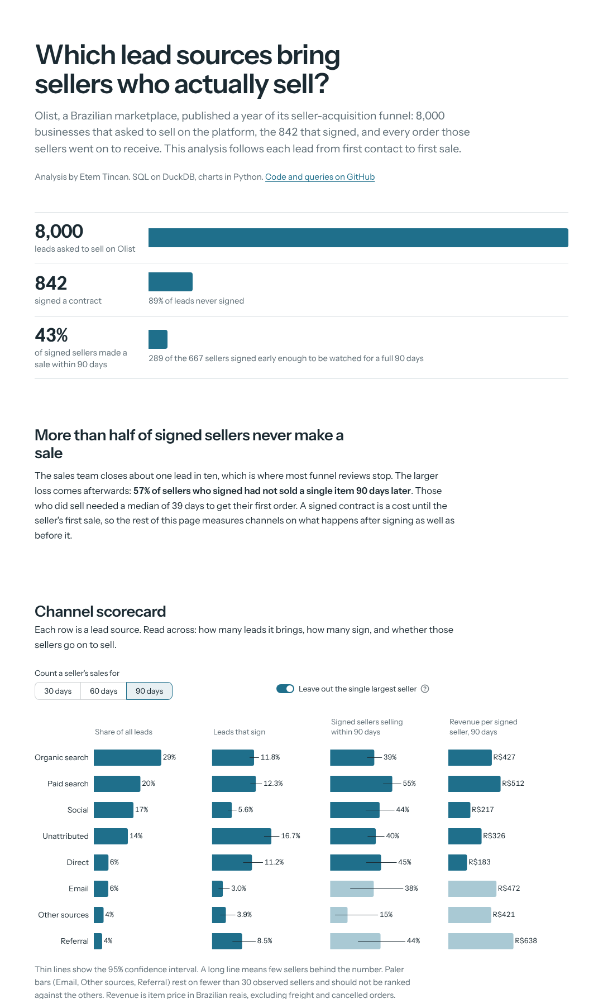

# Which lead sources bring sellers who actually sell?

An analysis of a marketplace's seller-acquisition funnel, from first contact to first sale.
Built on Olist's public data: 8,000 leads, 842 signed sellers and the orders they went on to receive.

**Live dashboard:** https://etemtincan-seller-acquisition-funnel-app-yerm8p.streamlit.app



## What it found

- **The biggest loss is after signing.** 57% of signed sellers had not made a single sale 90 days later.
  Of those, only one in five started selling in the following 90 days.
- **Paid and organic search sign at the same rate (12.3% vs 11.8%), but paid search sellers sell.**
  55% were active within 90 days against 39% from organic search.
- **Social supplies 17% of leads and signs 5.6% of them**, less than half the search rate, and takes twice as long to close.
- **The best-converting leads have no recorded source.** 14% of the funnel, signing at 16.7%.
- **Seller profile predicts sales better than channel does.** Large online sellers activate at 62%, offline businesses at 25%.

## How it is built

| Part | What it does |
|---|---|
| `sql/` | Every figure on the page. One file per question, readable on its own. |
| `funnel/db.py` | Loads the Parquet files into DuckDB and runs the SQL files. |
| `app.py` | The Streamlit page: charts (Plotly), confidence intervals, text built from query results. |
| `scripts/build_data.py` | Turns the raw Olist CSVs into the three small Parquet files in `data/`. |

Two decisions shape the numbers:

1. **Fair observation windows.** A seller counts toward a 90-day metric only if they signed at least
   90 days before the order data ends. Otherwise recent sellers look like failures because their
   sales have not happened yet.
2. **Rates over revenue.** One seller produced 22% of all 90-day revenue, so revenue per seller is
   reported with that seller left out by default, and the conclusions rest on rates.

There is no marketing spend in the data, so CAC and return on ad spend cannot be calculated.
The analysis ranks channels on the quality of what they bring, which is half of a budget decision.

## Run it

```bash
pip install -r requirements.txt
streamlit run app.py
```

To rebuild `data/` from the raw files:

```bash
python scripts/build_data.py <folder with the funnel CSVs> <folder with the e-commerce CSVs>
```

## Data

[Marketing Funnel by Olist](https://www.kaggle.com/datasets/olistbr/marketing-funnel-olist) and
[Brazilian E-Commerce Public Dataset by Olist](https://www.kaggle.com/datasets/olistbr/brazilian-ecommerce),
both released under CC BY-NC-SA 4.0. The data is real, sampled and anonymised.
Typeface: Instrument Sans (SIL Open Font License, see `static/OFL.txt`).
